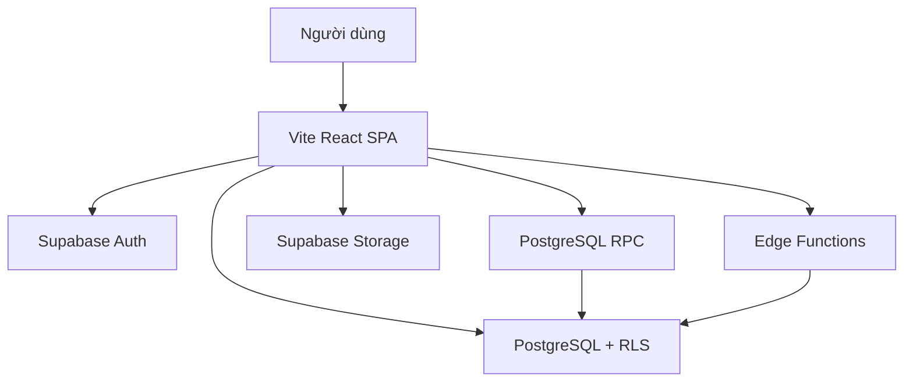
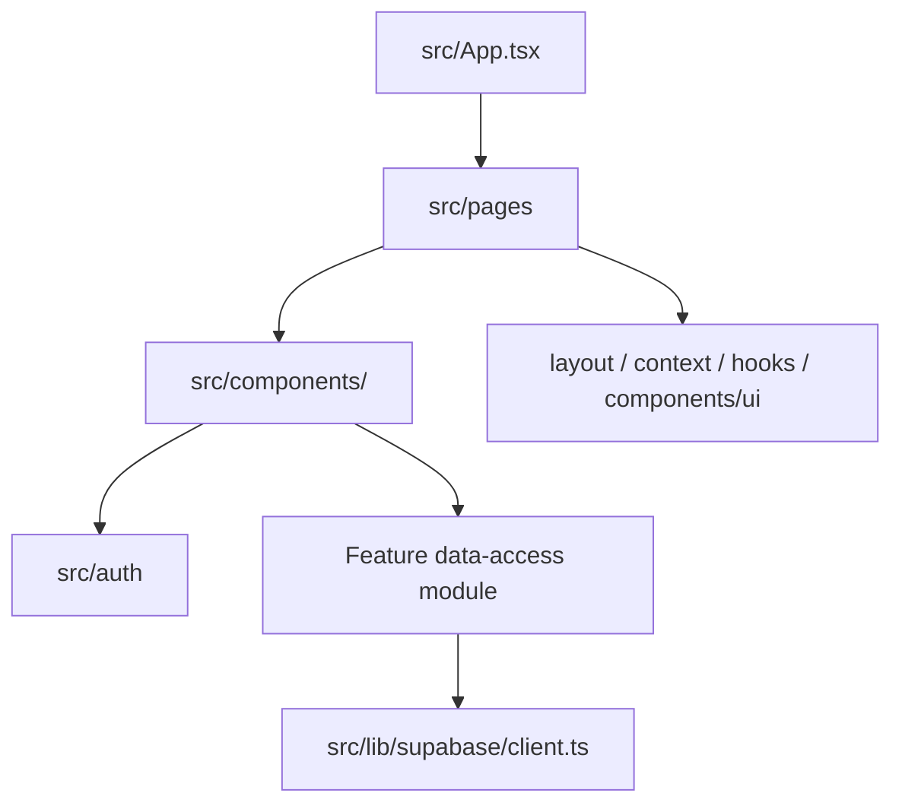
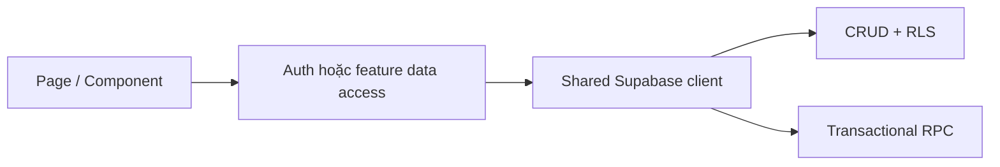
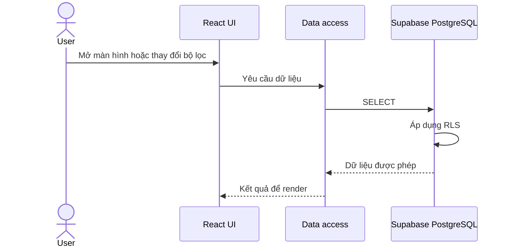
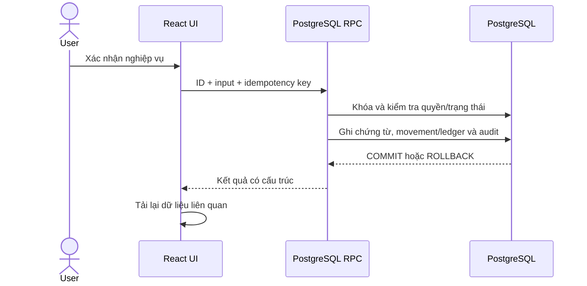
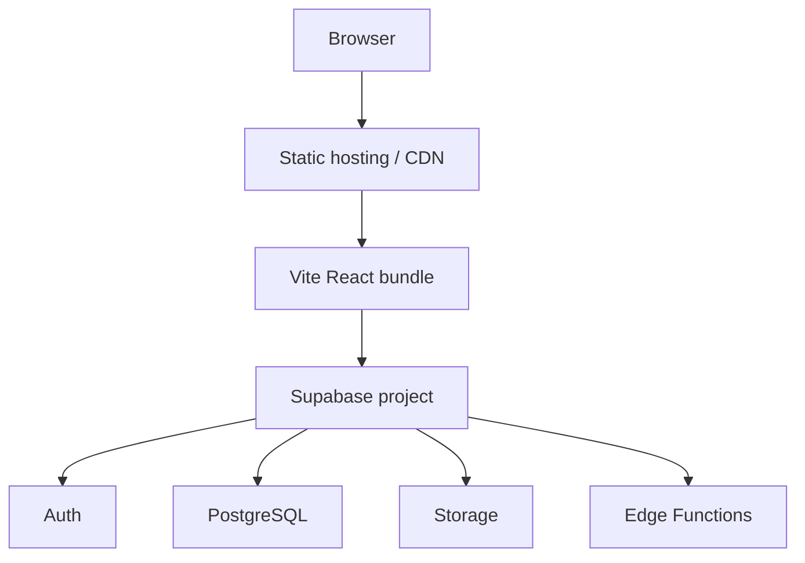

# ARCHITECTURE.md

## 1. Mục đích và phạm vi

Tài liệu này mô tả các **ranh giới kỹ thuật và hướng phụ thuộc** của hệ thống quản lý kho vật liệu xây dựng. Nó trả lời bốn câu hỏi:

1. Thành phần nào chịu trách nhiệm cho mỗi loại xử lý?
2. Frontend được phép giao tiếp với Supabase qua đường nào?
3. Nghiệp vụ nào phải chạy atomic ở database?
4. Code được tổ chức và phụ thuộc giữa các module ra sao?

Chi tiết thuộc tài liệu chuyên trách:

| Nội dung | Nguồn chính |
| --- | --- |
| Mục tiêu, phạm vi MVP, người dùng, module và tech stack | [PROJECT.md](../PROJECT.md) |
| Luật nghiệp vụ, trạng thái và công thức | [BUSINESS_RULES.md](BUSINESS_RULES.md) |
| Schema, RLS, RPC, index, migration và vận hành dữ liệu | [DATABASE.md](DATABASE.md) |
| Quy tắc triển khai, validation, lỗi và kiểm thử | [CODING_RULES.md](CODING_RULES.md) |
| Log công việc của AI agent | [LOGGING_RULES.md](LOGGING_RULES.md) |

Khi có mâu thuẫn, yêu cầu mới nhất của người dùng được ưu tiên; sau đó dùng đúng nguồn chính trong bảng trên. File này chỉ là nguồn chính cho cấu trúc hệ thống, ranh giới trách nhiệm và hướng phụ thuộc.

---

## 2. Mục tiêu kiến trúc

Kiến trúc ưu tiên theo thứ tự:

1. Tính đúng đắn của tồn kho và công nợ.
2. Bảo mật và phân quyền.
3. Khả năng truy vết.
4. Khả năng bảo trì.
5. Hiệu năng đã được đo.

MVP dùng một Vite SPA kết nối trực tiếp tới Supabase. Không thêm backend server hoặc microservice nếu Supabase Auth, PostgreSQL, RLS, RPC, Storage và Edge Functions đã giải quyết được yêu cầu.



---

## 3. Ranh giới thực thi

| Loại xử lý | Nơi thực thi |
| --- | --- |
| Render, điều hướng và tương tác | React page/component |
| Form state và phản hồi validation tức thời | Frontend |
| CRUD đơn giản đã được RLS bảo vệ | Data-access module dùng Supabase client |
| Phân quyền theo dữ liệu | PostgreSQL RLS |
| Constraint và toàn vẹn dữ liệu | PostgreSQL |
| Confirm, cancel, payment, return, stocktake | PostgreSQL RPC transaction |
| Secret hoặc tích hợp dịch vụ ngoài | Supabase Edge Function |
| File và ảnh | Supabase Storage |
| Cập nhật giao diện theo sự kiện | Supabase Realtime khi có nhu cầu thực tế |

### 3.1. PostgreSQL RPC

Dùng RPC khi thao tác cần một trong các đặc tính sau:

- Thay đổi nhiều bảng trong một transaction.
- Lock dữ liệu hoặc chống race condition.
- Thay đổi tồn kho, ledger, thanh toán hoặc số tiền tổng hợp.
- Kiểm tra quyền và trạng thái ngay trước khi ghi.
- Chống request gửi lặp bằng idempotency.

Frontend không được ghép nhiều request độc lập để hoàn thành một nghiệp vụ atomic.

### 3.2. Edge Function

Chỉ dùng Edge Function khi cần giữ secret, gọi dịch vụ ngoài, gửi email/webhook hoặc kiểm soát request server-side ngoài khả năng RPC. Không dùng Edge Function chỉ để bọc CRUD đơn giản.

---

## 4. Kiến trúc frontend

Code hiện tại dùng cấu trúc page + component theo feature:



Trách nhiệm:

| Khu vực | Trách nhiệm |
| --- | --- |
| `src/App.tsx` | Đăng ký route và chọn layout |
| `src/pages/` | Ghép layout, component và dữ liệu cho từng route |
| `src/components/<feature>/` | UI và hành vi theo domain |
| `src/components/ui/`, `src/components/common/` | Primitive và thành phần dùng chung |
| `src/auth/` | Session, profile, đăng nhập và route protection |
| `src/context/`, `src/hooks/` | State chia sẻ và hook dùng chung thực sự |
| `src/lib/supabase/` | Supabase client dùng chung |
| `src/locales/` | Nội dung hiển thị theo locale |

Quy tắc phụ thuộc:

```text
App / pages
    -> feature components
        -> auth hoặc data-access module
            -> shared Supabase client

App / pages / feature components
    -> shared UI, context, hooks và utilities
```

- Shared code không import ngược một feature cụ thể.
- Feature không import page của feature khác.
- Component trình bày không tự điều phối transaction nghiệp vụ.
- Chỉ tạo abstraction hoặc thư mục con khi feature hiện tại cần dùng.
- Không tạo `src/features/` song song với cấu trúc hiện tại nếu chưa có quyết định migration riêng.

---

## 5. Data access và trust boundary

Supabase browser client chỉ được khởi tạo tại `src/lib/supabase/client.ts`. Page/component không khởi tạo client mới.



Hai đường ghi dữ liệu:

1. **CRUD trực tiếp:** dành cho dữ liệu đơn giản hoặc bản nháp, luôn được RLS bảo vệ.
2. **RPC bắt buộc:** dành cho thao tác thay đổi trạng thái đã xác nhận, tồn kho, công nợ, payment, return hoặc nhiều bảng.

Frontend chỉ giữ public Supabase URL, anon/publishable key và session hiện tại. `service_role` và secret không được xuất hiện trong source frontend, biến `VITE_*`, log hoặc repository.

Database types sinh từ schema là nguồn type cho dữ liệu Supabase. Khi migration đổi schema, phải sinh lại types; không sửa generated types thủ công.

---

## 6. Authentication và authorization

Supabase Auth là nguồn xác thực duy nhất. Hồ sơ nghiệp vụ tham chiếu `auth.users(id)` và không lưu password trong public schema.

Authorization dùng ba lớp:

1. Frontend ẩn hoặc vô hiệu hóa hành động để cải thiện UX.
2. RLS giới hạn dữ liệu có thể đọc và CRUD trực tiếp.
3. RPC tự kiểm tra `auth.uid()`, role, trạng thái tài khoản và luật nghiệp vụ trước khi ghi.

Frontend không phải security boundary. Chi tiết bảng profile, helper quyền, RLS và `SECURITY DEFINER` thuộc [DATABASE.md](DATABASE.md).

---

## 7. Luồng dữ liệu chính

### 7.1. Đọc dữ liệu



### 7.2. Nghiệp vụ atomic



Transaction boundary, locking, idempotency và thao tác RPC cụ thể được định nghĩa trong [database/06-rpc-and-transactions.md](database/06-rpc-and-transactions.md).

---

## 8. Tính nhất quán và lịch sử

Các quyết định kiến trúc bảo vệ dữ liệu:

- Một hành động người dùng làm thay đổi nhiều bảng tương ứng với một database transaction.
- Tồn kho và công nợ chỉ thay đổi qua nghiệp vụ có nguồn rõ ràng.
- Movement, ledger và audit là append-only; hủy hoặc sửa sai dùng bản ghi đảo.
- Dữ liệu tổng hợp như tồn hiện tại hoặc số tiền đã trả không được client sửa trực tiếp.
- Action nhạy cảm phải idempotent để double click hoặc retry mạng không tạo bản ghi trùng.

Công thức, trạng thái và điều kiện hợp lệ thuộc [BUSINESS_RULES.md](BUSINESS_RULES.md); bảng, constraint và RPC triển khai thuộc [DATABASE.md](DATABASE.md).

---

## 9. Storage, Realtime và reporting

- File nghiệp vụ lưu trong Supabase Storage; database chỉ giữ metadata và quan hệ.
- File nhạy cảm dùng bucket private và policy/signed URL phù hợp.
- Realtime chỉ thông báo thay đổi; nó không thay thế transaction hoặc nguồn dữ liệu chính thức.
- Báo cáo lớn được lọc và tổng hợp tại database, không tải toàn bộ dữ liệu về browser để tính.
- Không thêm Redis, data warehouse hoặc background pipeline trước khi có nhu cầu được đo.

Policy, view, index, retention và vận hành chi tiết thuộc [database/07-security-operations-reporting.md](database/07-security-operations-reporting.md).

---

## 10. Cấu trúc repository

Các đường dẫn kiến trúc chính:

```text
root/
├── src/
│   ├── auth/
│   ├── components/
│   │   ├── common/
│   │   ├── ui/
│   │   └── <feature>/
│   ├── context/
│   ├── hooks/
│   ├── layout/
│   ├── lib/
│   │   └── supabase/
│   ├── locales/
│   ├── pages/
│   ├── utils/
│   └── App.tsx
├── supabase/
│   ├── functions/
│   ├── migrations/
│   ├── tests/
│   ├── config.toml
│   └── seed.sql
└── docs/
```

Cấu trúc chi tiết và quy tắc đặt file/component thuộc [CODING_RULES.md](CODING_RULES.md). File này chỉ quy định hướng phụ thuộc giữa các khu vực.

---

## 11. Deployment boundary



Frontend và Supabase được triển khai độc lập. Schema chỉ thay đổi bằng migration được version trong repository; quy trình migration, backup và kiểm thử thuộc [DATABASE.md](DATABASE.md) và [CODING_RULES.md](CODING_RULES.md).

---

## 12. Quyết định kiến trúc

### ADR-001: Vite SPA

- **Trạng thái:** Accepted.
- **Quyết định:** dùng Vite, React và TypeScript cho ứng dụng nội bộ.
- **Lý do:** không có nhu cầu SSR/SEO trong MVP.
- **Hệ quả:** route guard chạy phía client, nhưng authorization thật vẫn ở Supabase.

### ADR-002: Supabase thay backend riêng

- **Trạng thái:** Accepted.
- **Quyết định:** dùng Supabase Auth, PostgreSQL, RLS, RPC, Storage và Edge Functions.
- **Lý do:** giảm thời gian xây dựng và vận hành MVP.
- **Hệ quả:** RLS, function và migration là một phần của application architecture và phải được kiểm thử.

### ADR-003: Nghiệp vụ nhạy cảm chạy bằng RPC

- **Trạng thái:** Accepted.
- **Quyết định:** confirm, cancel, payment, return và stocktake không được điều phối bằng nhiều request từ browser.
- **Lý do:** cần transaction, locking, idempotency và tính nhất quán.
- **Hệ quả:** RPC là service boundary cho các use case này.

### ADR-004: Page và component theo feature

- **Trạng thái:** Accepted.
- **Quyết định:** route nằm trong `src/pages`, UI nghiệp vụ nằm trong `src/components/<feature>` và shared code nằm trong các thư mục dùng chung hiện có.
- **Lý do:** phù hợp cấu trúc TailAdmin hiện tại và tránh migration không cần thiết.
- **Hệ quả:** phải giữ hướng phụ thuộc ở mục 4 và không tạo cây `src/features` song song.

### ADR-005: Lịch sử append-only

- **Trạng thái:** Accepted.
- **Quyết định:** movement, ledger và audit không bị sửa/xóa sau khi ghi nhận.
- **Lý do:** bảo đảm truy vết và đối soát.
- **Hệ quả:** hủy hoặc sửa sai dùng bản ghi đảo có liên kết.

Khi thay đổi một quyết định đã accepted, tạo ADR mới và đánh dấu ADR cũ là superseded thay vì xóa lịch sử.

---

## 13. Checklist thay đổi kiến trúc

Chỉ dùng checklist này khi thay đổi ranh giới hoặc data flow:

- [ ] Thành phần chịu trách nhiệm đã rõ và không trùng ownership?
- [ ] Hướng phụ thuộc có tuân theo mục 4?
- [ ] CRUD hay RPC đã được chọn đúng theo trust boundary?
- [ ] Thay đổi có cần cập nhật `PROJECT.md`, business rules hoặc database docs?
- [ ] Quyết định khó đảo ngược đã được ghi thành ADR?

Checklist triển khai feature, kiểm thử và AI logging nằm trong các tài liệu chuyên trách, không lặp lại tại đây.
