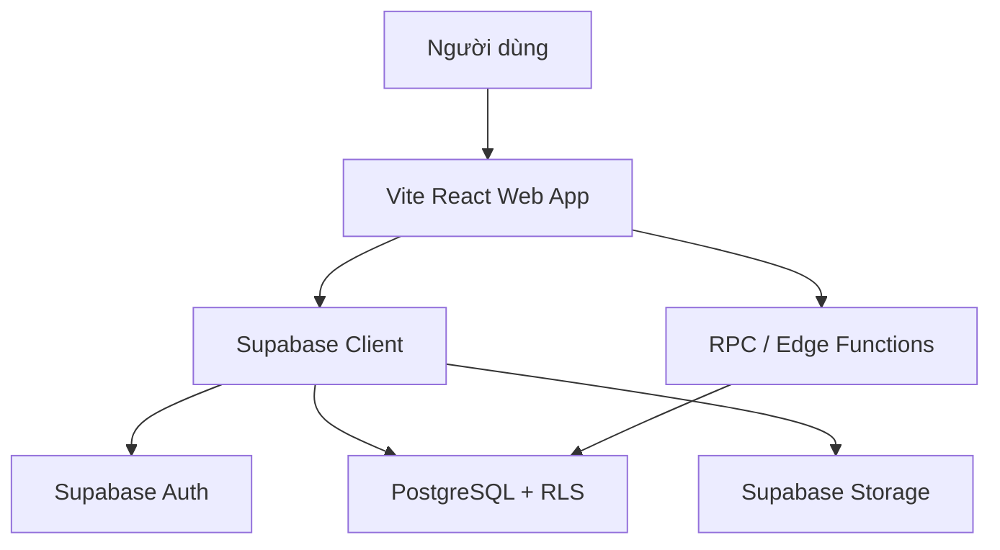
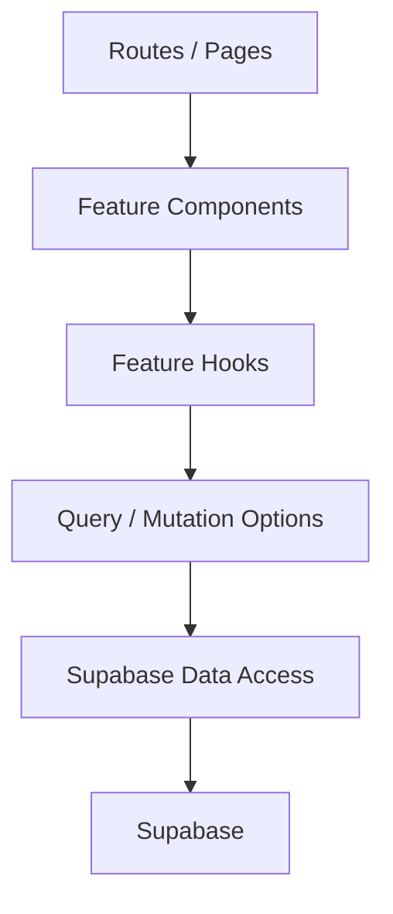
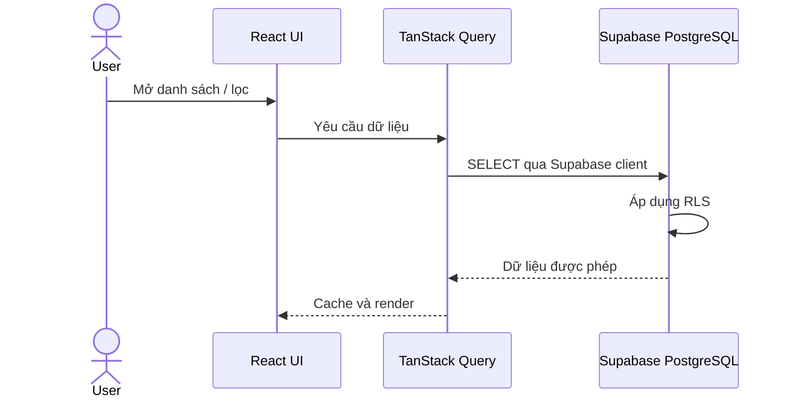
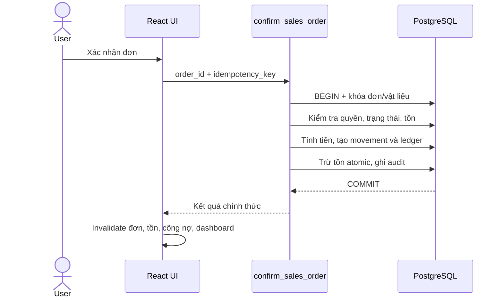
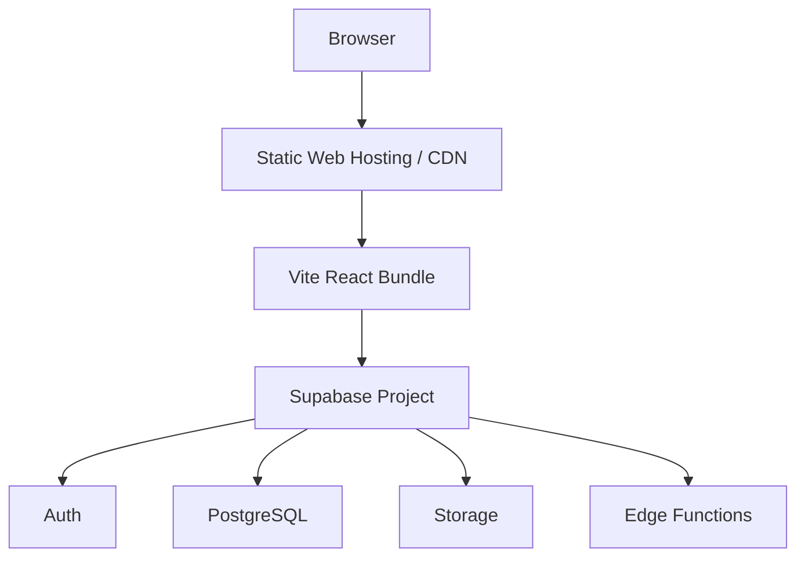

# ARCHITECTURE.md

## 1. Mục đích

Tài liệu này mô tả kiến trúc kỹ thuật của hệ thống web quản lý kho vật liệu xây dựng. Đây là nguồn tham chiếu để AI và lập trình viên biết:

- Hệ thống được chia thành những phần nào.
- Mỗi loại logic phải được đặt ở đâu.
- Frontend giao tiếp với Supabase như thế nào.
- Những nghiệp vụ nào bắt buộc chạy trong database transaction.
- Cách bảo vệ tồn kho, công nợ và dữ liệu đã xác nhận.
- Cấu trúc thư mục và quy tắc phụ thuộc giữa các module.

Tài liệu này không thay thế:

- `PROJECT.md`: mục tiêu, phạm vi và tech stack.
- `BUSINESS_RULES.md`: luật nghiệp vụ.
- `DATABASE.md`: schema, bảng, cột, index và constraint.
- `CODING_RULES.md`: quy tắc viết code.

Nếu có mâu thuẫn:

1. Luật nghiệp vụ ưu tiên `BUSINESS_RULES.md`.
2. Tech stack và phạm vi ưu tiên `PROJECT.md`.
3. Cấu trúc hệ thống và ranh giới trách nhiệm ưu tiên file này.
4. Schema chi tiết ưu tiên `DATABASE.md`, trừ các điểm phải thay đổi để tích hợp đúng Supabase Auth.

---

## 2. Mục tiêu kiến trúc

Kiến trúc phải đáp ứng các mục tiêu sau:

- Đủ đơn giản để phát triển MVP nhanh.
- Không cần duy trì một backend server riêng ở giai đoạn đầu.
- Tách UI, truy cập dữ liệu và nghiệp vụ để dễ bảo trì.
- Phân quyền ở database, không chỉ ẩn nút trên giao diện.
- Không cho phép client sửa trực tiếp tồn kho, công nợ hoặc số tiền tổng hợp.
- Các nghiệp vụ nhiều bước phải thành công toàn bộ hoặc rollback toàn bộ.
- Truy vết được ai đã tạo, xác nhận, hủy hoặc điều chỉnh dữ liệu.
- Cho phép mở rộng sau này mà không cần chuyển sang microservices sớm.

Các ưu tiên theo thứ tự:

1. Tính đúng đắn của tồn kho và công nợ.
2. Bảo mật và phân quyền.
3. Khả năng truy vết.
4. Khả năng bảo trì.
5. Hiệu năng.

---

## 3. Quyết định kiến trúc chính

### 3.1. Kiểu kiến trúc

Hệ thống sử dụng kiến trúc **frontend theo feature kết hợp Supabase Backend-as-a-Service**.



Không xây dựng Express, NestJS hoặc một backend server riêng theo mặc định.

### 3.2. Nguyên tắc chọn nơi thực thi

| Loại xử lý | Nơi thực thi |
|---|---|
| Render UI, tương tác người dùng | React component |
| Form state và validation trải nghiệm | React Hook Form + Zod |
| Fetch, cache, refetch server state | TanStack Query |
| Truy vấn CRUD đơn giản đã được RLS bảo vệ | Supabase client |
| Phân quyền dữ liệu | PostgreSQL RLS |
| Constraint và toàn vẹn dữ liệu | PostgreSQL |
| Confirm/cancel/payment/return/stocktake | PostgreSQL RPC transaction |
| Tích hợp secret hoặc dịch vụ bên ngoài | Supabase Edge Function |
| File và ảnh | Supabase Storage |
| Cập nhật realtime khi thực sự cần | Supabase Realtime |

### 3.3. Khi nào cần Edge Function

Chỉ dùng Edge Function khi nghiệp vụ:

- Cần secret không được đưa xuống trình duyệt.
- Gọi dịch vụ bên ngoài.
- Gửi email, webhook hoặc chạy tác vụ server-side.
- Cần kiểm soát request/response ngoài khả năng RPC.

Không dùng Edge Function chỉ để bọc một truy vấn CRUD đơn giản.

### 3.4. Khi nào cần PostgreSQL RPC

Dùng RPC cho thao tác cần transaction, locking, atomic update hoặc thay đổi nhiều bảng, gồm tối thiểu:

- Xác nhận và hủy phiếu nhập.
- Xác nhận và hủy đơn bán.
- Xác nhận trả hàng.
- Ghi nhận hoặc đảo thanh toán.
- Xác nhận kiểm kho và điều chỉnh tồn.
- Sinh mã chứng từ tuần tự.

---

## 4. Tech stack

### 4.1. Frontend

- Vite.
- React.
- TypeScript.
- Tailwind CSS.
- shadcn/ui.
- React Router.
- TanStack Query.
- React Hook Form.
- Zod.
- Supabase JavaScript client.

### 4.2. Backend platform

- Supabase Auth: xác thực người dùng.
- PostgreSQL: dữ liệu nghiệp vụ và transaction.
- Row Level Security: phân quyền theo dòng dữ liệu.
- Database Functions/RPC: nghiệp vụ atomic.
- Supabase Storage: ảnh vật liệu và chứng từ đính kèm.
- Supabase Realtime: cập nhật chọn lọc khi có nhu cầu.
- Supabase Edge Functions: xử lý server-side cần secret/tích hợp ngoài.

### 4.3. Nguyên tắc dependency

- Chỉ thêm thư viện khi có nhu cầu thực tế.
- Không thêm một state manager toàn cục nếu React state và TanStack Query đã đủ.
- Không sử dụng ORM ở frontend.
- Database schema thay đổi bằng Supabase migration, không chỉnh production thủ công.

---

## 5. System context

### 5.1. Người dùng

| Vai trò | Trách nhiệm chính |
|---|---|
| `ADMIN` | Quản lý người dùng, danh mục, toàn bộ nghiệp vụ và báo cáo |
| `WAREHOUSE_STAFF` | Nhập kho, kiểm kho, điều chỉnh và xem tồn kho theo quyền |

Quyền chi tiết phải được định nghĩa trong `BUSINESS_RULES.md` và triển khai bằng RLS/RPC.

### 5.2. Hệ thống bên ngoài

Trong MVP, hệ thống không phụ thuộc bắt buộc vào:

- Sàn thương mại điện tử.
- Phần mềm kế toán.
- Đơn vị vận chuyển.
- Cổng thanh toán online.
- Dịch vụ barcode.

Nếu bổ sung tích hợp ngoài, tất cả secret và chữ ký phải được xử lý trong Edge Function.

---

## 6. Các module ứng dụng

| Module | Trách nhiệm |
|---|---|
| `auth` | Đăng nhập, đăng xuất, session, route protection |
| `users` | Hồ sơ người dùng, vai trò, kích hoạt/vô hiệu hóa |
| `dashboard` | Chỉ số tổng quan và cảnh báo |
| `categories` | Danh mục nhóm vật liệu |
| `units` | Đơn vị tính |
| `materials` | Thông tin vật liệu, giá mặc định, mức tồn tối thiểu |
| `suppliers` | Nhà cung cấp |
| `customers` | Khách hàng và khách lẻ hệ thống |
| `purchases` | Phiếu nhập và thanh toán nhà cung cấp |
| `sales` | Đơn bán kiêm phiếu xuất và thu tiền |
| `returns` | Trả hàng bán và trả hàng nhập |
| `inventory` | Tồn hiện tại và lịch sử biến động |
| `stocktakes` | Kiểm kho và điều chỉnh chênh lệch |
| `debts` | Công nợ khách hàng và nhà cung cấp |
| `reports` | Báo cáo nhập, bán, tồn, công nợ cơ bản |
| `audit` | Lịch sử thao tác quan trọng |

Các module không được tự tạo luật nghiệp vụ trái với `BUSINESS_RULES.md`.

---

## 7. Frontend architecture

### 7.1. Các lớp frontend



Trách nhiệm từng lớp:

- `routes/pages`: ghép layout và feature, xử lý route params.
- `components`: trình bày và tương tác UI.
- `hooks`: điều phối hành vi của feature.
- `queries/mutations`: cấu hình TanStack Query và cache invalidation.
- `api`: giao tiếp Supabase, không chứa UI state.
- `schemas`: Zod schema cho form và dữ liệu đầu vào phía client.
- `types`: kiểu dữ liệu riêng của feature.

### 7.2. Quy tắc component

- Page không gọi Supabase trực tiếp.
- Presentational component không chứa nghiệp vụ kho/công nợ.
- Component dùng dữ liệu qua props hoặc feature hook.
- Form chỉ thu thập và validate input; kết quả tài chính chính thức phải được tính lại ở database.
- Component dùng chung không được import ngược từ feature.

### 7.3. Routing

Routes được chia theo module và bảo vệ bằng authentication guard.

Ví dụ:

```text
/login
/dashboard
/materials
/suppliers
/customers
/purchases
/sales
/inventory
/stocktakes
/debts
/reports
/users
```

Route guard chỉ cải thiện UX. Quyền truy cập thật phải được kiểm tra bằng RLS và RPC.

---

## 8. State management

Phân loại state như sau:

| Loại state | Công cụ |
|---|---|
| Server state | TanStack Query |
| Form state | React Hook Form |
| Validation | Zod |
| Auth session | Supabase Auth + Auth Provider |
| UI state cục bộ | `useState` / `useReducer` |
| State chia sẻ nhỏ | React Context khi thật sự cần |

Không sao chép dữ liệu server vào global store.

TanStack Query phải quản lý:

- Query key có cấu trúc và đặt tập trung theo feature.
- Pagination, filter và search là một phần của query key.
- Mutation thành công phải invalidate hoặc cập nhật đúng cache liên quan.
- Không optimistic update cho confirm/cancel/tồn kho/thanh toán nếu chưa có cơ chế rollback đáng tin cậy.
- Dữ liệu tồn kho phải được refetch sau mutation làm thay đổi tồn.

---

## 9. Data access architecture

### 9.1. Supabase client

Chỉ khởi tạo Supabase browser client tại:

```text
src/lib/supabase/client.ts
```

Không tạo client rải rác trong component hoặc feature.

Frontend chỉ được sử dụng:

- Supabase URL công khai.
- Anon/publishable key.
- Session của người dùng hiện tại.

`service_role` key tuyệt đối không xuất hiện trong source frontend, biến `VITE_*`, log hoặc repository.

### 9.2. Các kiểu thao tác dữ liệu

#### CRUD trực tiếp

Có thể dùng Supabase client trực tiếp qua feature API cho:

- Đọc danh mục.
- Tạo/sửa bản nháp theo RLS.
- Tìm kiếm và phân trang.
- Đọc dashboard/report view đã được cấp quyền.

#### RPC bắt buộc

Không cho frontend tự ghép nhiều lệnh CRUD cho:

- Confirm.
- Cancel.
- Payment/reversal.
- Return confirmation.
- Stocktake confirmation.
- Bất kỳ thay đổi nào tới `current_stock`, ledger hoặc số tiền tổng hợp.

### 9.3. Type safety

- Sinh TypeScript types từ Supabase schema.
- Database types sinh tự động không được sửa thủ công.
- Feature có thể định nghĩa DTO/view model riêng để phù hợp UI.
- Sau mỗi migration làm đổi schema, phải sinh lại database types.

---

## 10. Authentication architecture

### 10.1. Nguồn xác thực

Supabase Auth là nguồn xác thực duy nhất.

- Mật khẩu do Supabase Auth quản lý.
- Không tạo `password_hash` trong public schema.
- Không tự xây dựng login token hoặc refresh token.
- Session được Supabase client quản lý.

### 10.2. Hồ sơ người dùng

Public schema dùng bảng `profiles` hoặc `users` chỉ để lưu hồ sơ nghiệp vụ:

```text
profiles.id -> auth.users.id
profiles.full_name
profiles.role
profiles.is_active
profiles.created_at
profiles.updated_at
```

Nếu giữ tên bảng `users` theo `DATABASE.md`, bảng đó vẫn phải tham chiếu `auth.users(id)` và phải loại bỏ `password_hash`.

### 10.3. Vô hiệu hóa tài khoản

- `is_active = false` phải khiến người dùng không thể thực hiện nghiệp vụ.
- RLS/RPC phải kiểm tra trạng thái active, không chỉ frontend.
- ADMIN không được tự vô hiệu hóa tài khoản admin cuối cùng nếu business rule cấm.

---

## 11. Authorization và RLS

### 11.1. Nguyên tắc

- Bật RLS cho mọi bảng public có dữ liệu ứng dụng.
- Không dùng policy kiểu cho phép mọi authenticated user ghi toàn bộ dữ liệu.
- Mặc định từ chối, chỉ mở đúng hành động cần thiết.
- Role lấy từ hồ sơ server-side đáng tin cậy, không lấy từ input client.
- RPC nghiệp vụ phải tự kiểm tra quyền của `auth.uid()`.

### 11.2. Defense in depth

Mỗi thao tác nhạy cảm được bảo vệ ở ba mức:

1. Frontend ẩn/vô hiệu hóa hành động không được phép.
2. RLS giới hạn đọc và CRUD trực tiếp.
3. RPC kiểm tra role, trạng thái và luật nghiệp vụ trước khi ghi.

Ẩn nút không phải là phân quyền.

### 11.3. Security definer

Nếu RPC dùng `SECURITY DEFINER`:

- Chỉ cấp `EXECUTE` cho role cần thiết.
- Luôn đặt `search_path` rõ ràng.
- Schema-qualify tên bảng/hàm.
- Không nhận user ID từ client để thay cho `auth.uid()`.
- Validate toàn bộ input.
- Không trả dữ liệu vượt quyền người gọi.

---

## 12. Luồng dữ liệu chính

### 12.1. Đọc danh sách



### 12.2. Xác nhận đơn bán



### 12.3. Nguyên tắc response

RPC nên trả dữ liệu đủ để frontend xác định kết quả:

```ts
type OperationResult<T> = {
  success: boolean;
  data: T | null;
  error_code: string | null;
  message: string | null;
};
```

Không phụ thuộc vào text lỗi PostgreSQL để xác định nghiệp vụ ở frontend.

---

## 13. Transaction và tính nhất quán

### 13.1. Transaction boundary

Một action nghiệp vụ của người dùng phải tương ứng với một transaction khi action đó làm thay đổi nhiều bảng.

Ví dụ xác nhận phiếu nhập phải atomic:

```text
receipt status
+ inventory movements
+ current stock
+ supplier debt ledger
+ optional payment
+ audit log
```

Không gọi lần lượt năm request từ frontend để thực hiện nghiệp vụ này.

### 13.2. State transition

Chứng từ tuân theo:

```text
DRAFT -> CONFIRMED -> CANCELLED
```

- Chỉ `DRAFT` được sửa nội dung.
- `CONFIRMED` không được sửa item trực tiếp.
- `CANCELLED` dùng movement/ledger đảo, không xóa lịch sử.
- RPC phải kiểm tra trạng thái hiện tại sau khi khóa bản ghi.

### 13.3. Inventory consistency

- `inventory_movements` là nguồn lịch sử chính thức.
- `materials.current_stock` là số tổng hợp đọc nhanh.
- Không có API/RLS policy cho client update trực tiếp `current_stock`.
- Trừ tồn dùng atomic conditional update.
- Kiểm tra tồn và trừ tồn phải ở cùng transaction.
- Khi khóa nhiều vật liệu, khóa theo thứ tự ID cố định để giảm deadlock.
- Không cho tồn âm.

### 13.4. Debt consistency

- `debt_ledger_entries` là nguồn lịch sử công nợ chính thức.
- Không lưu số dư có thể sửa trực tiếp trên customer/supplier.
- Payment, return và cancellation phải tạo ledger tương ứng.
- Các cột `paid_amount`, `debt_amount`, `payment_status` là dữ liệu tổng hợp và chỉ được cập nhật từ RPC.

### 13.5. Idempotency

Các action confirm, cancel, payment và return phải chống gửi lặp.

- Frontend sinh `idempotency_key` cho mỗi ý định thao tác.
- Database có unique constraint theo key/nguồn.
- Cùng key và cùng payload trả lại kết quả cũ hoặc trạng thái hiện tại.
- Cùng key nhưng payload khác phải bị từ chối.
- Double click hoặc retry mạng không được sinh movement/payment/ledger trùng.

---

## 14. Validation strategy

Validation được chia thành bốn lớp:

| Lớp | Trách nhiệm | Ví dụ |
|---|---|---|
| UI | Phản hồi nhanh | Trường bắt buộc, định dạng số |
| Zod | Parse input/form | Quantity > 0, chuỗi hợp lệ |
| RPC/business | Luật liên bảng | Đủ tồn, đúng trạng thái, đúng đối tác |
| Database | Toàn vẹn cuối cùng | FK, UNIQUE, CHECK, NOT NULL |

Nguyên tắc:

- Frontend validation không phải hàng rào bảo mật.
- Tiền và tổng số lượng phải được tính lại server-side.
- Không tin `total_amount`, `paid_amount`, `debt_amount`, role hoặc creator ID do client gửi.
- Quy tắc liên bảng phải được kiểm tra trong cùng transaction.

---

## 15. Error handling

### 15.1. Nhóm lỗi

| Nhóm | Ví dụ | Cách xử lý UI |
|---|---|---|
| Validation | Dữ liệu thiếu/sai định dạng | Hiển thị tại field |
| Authentication | Session hết hạn | Yêu cầu đăng nhập lại |
| Authorization | Không đủ quyền | Trang 403/thông báo rõ ràng |
| Business | Không đủ tồn, sai trạng thái | Thông báo nghiệp vụ, giữ form |
| Conflict | Dữ liệu đã thay đổi | Refetch và yêu cầu kiểm tra lại |
| System/network | Timeout, lỗi không xác định | Thông báo chung và cho retry an toàn |

### 15.2. Error code

RPC/Edge Function phải dùng mã lỗi ổn định, ví dụ:

```text
AUTH_REQUIRED
PERMISSION_DENIED
DOCUMENT_NOT_FOUND
INVALID_DOCUMENT_STATUS
INSUFFICIENT_STOCK
DUPLICATE_OPERATION
PAYMENT_EXCEEDS_DEBT
RETURN_EXCEEDS_ORIGINAL
```

Frontend map `error_code` sang thông báo tiếng Việt. Không so sánh message tự do để điều khiển logic.

### 15.3. Retry

- Query đọc có thể retry có giới hạn.
- Mutation CRUD idempotent có thể retry thận trọng.
- Mutation tài chính/tồn kho chỉ retry khi có idempotency key.
- Không retry vô hạn.

---

## 16. Logging và audit

### 16.1. Audit nghiệp vụ

Phải ghi audit cho tối thiểu:

- Tạo/sửa/xác nhận/hủy chứng từ.
- Thanh toán và đảo thanh toán.
- Kiểm kho và điều chỉnh tồn.
- Thay đổi role hoặc trạng thái tài khoản.
- Thay đổi dữ liệu danh mục quan trọng.

Audit cần có:

- `user_id` từ `auth.uid()`.
- Action.
- Entity type và ID.
- Dữ liệu trước/sau khi phù hợp.
- Thời điểm.
- Request/idempotency ID nếu có.

Audit là append-only và không được chứa token, mật khẩu hoặc secret.

### 16.2. Technical logs

Edge Function phải dùng structured logging, kèm request ID. Không log toàn bộ payload nếu chứa dữ liệu cá nhân hoặc secret.

Lỗi UI có thể ghi nhận ở dịch vụ monitoring sau MVP, nhưng thông báo cho người dùng không được lộ stack trace hay chi tiết database.

---

## 17. File và asset storage

- Ảnh vật liệu và file chứng từ lưu trong Supabase Storage.
- Database chỉ lưu path, metadata và quan hệ với entity.
- Bucket phải private nếu file chứa hóa đơn, thông tin khách hàng hoặc chứng từ.
- Truy cập file private qua policy hoặc signed URL thời hạn ngắn.
- RLS/Storage policy phải theo cùng quyền với entity liên quan.
- Giới hạn MIME type và dung lượng upload.
- Không dùng filename người dùng gửi làm identifier duy nhất.
- Khi xóa entity, không xóa file nghiệp vụ đã cần cho audit nếu chưa có retention policy rõ ràng.

---

## 18. Realtime và caching

### 18.1. Realtime

MVP không bật Realtime cho mọi bảng.

Chỉ cân nhắc dùng cho:

- Cảnh báo tồn thay đổi khi nhiều nhân viên cùng làm việc.
- Dashboard cần tự cập nhật.
- Trạng thái chứng từ đang được người khác xử lý.

Sau event realtime, ưu tiên invalidate/refetch query thay vì tự ghép toàn bộ business state ở client.

### 18.2. Caching

- TanStack Query là cache phía client chính.
- Danh mục ít đổi có thể dùng `staleTime` dài hơn.
- Tồn kho, công nợ và trạng thái chứng từ dùng `staleTime` ngắn.
- Mutation ảnh hưởng dữ liệu phải invalidate đúng các query liên quan.
- Không thêm Redis hoặc cache server trong MVP.
- Không coi cache là nguồn dữ liệu chính thức.

---

## 19. Reporting architecture

Báo cáo cơ bản đọc từ:

- SQL view.
- Database function có filter/pagination.
- Bảng tổng hợp hiện có, được đối soát với movement/ledger.

Quy tắc:

- Không tải toàn bộ dữ liệu về browser để tính báo cáo lớn.
- Filter ngày, trạng thái, khách hàng, nhà cung cấp và vật liệu tại database.
- Doanh thu, dòng tiền và công nợ là ba chỉ số khác nhau.
- Báo cáo chỉ tính chứng từ hợp lệ theo business rules.
- Export lớn nên chuyển sang Edge Function/background flow khi phát sinh nhu cầu.

Không xây data warehouse hoặc BI pipeline trong MVP.

---

## 20. Folder structure

```text
root/
├── public/
├── src/
│   ├── app/
│   │   ├── router/
│   │   ├── providers/
│   │   └── layouts/
│   ├── components/
│   │   ├── ui/
│   │   └── shared/
│   ├── features/
│   │   ├── auth/
│   │   ├── users/
│   │   ├── dashboard/
│   │   ├── materials/
│   │   ├── categories/
│   │   ├── units/
│   │   ├── suppliers/
│   │   ├── customers/
│   │   ├── purchases/
│   │   ├── sales/
│   │   ├── returns/
│   │   ├── inventory/
│   │   ├── stocktakes/
│   │   ├── debts/
│   │   ├── reports/
│   │   └── audit/
│   ├── hooks/
│   ├── lib/
│   │   ├── supabase/
│   │   │   ├── client.ts
│   │   │   └── database.types.ts
│   │   ├── query-client.ts
│   │   └── utils.ts
│   ├── schemas/
│   ├── types/
│   ├── styles/
│   ├── main.tsx
│   └── vite-env.d.ts
├── supabase/
│   ├── migrations/
│   ├── functions/
│   ├── tests/
│   ├── seed.sql
│   └── config.toml
├── tests/
│   ├── integration/
│   └── e2e/
├── .env.example
├── PROJECT.md
├── BUSINESS_RULES.md
├── DATABASE.md
├── CODING_RULES.md
└── ARCHITECTURE.md
```

### 20.1. Cấu trúc một feature

```text
features/materials/
├── api/
│   └── materials.api.ts
├── components/
├── hooks/
├── pages/
├── queries/
│   ├── materials.keys.ts
│   ├── materials.queries.ts
│   └── materials.mutations.ts
├── schemas/
├── types/
└── index.ts
```

Không bắt buộc tạo mọi thư mục nếu feature chưa cần. Tránh file rỗng và abstraction sớm.

---

## 21. Dependency rules

Luồng phụ thuộc hợp lệ:

```text
app/routes
  -> features
  -> shared components / hooks / lib
```

| Import | Cho phép |
|---|---|
| `app` import `features` | Có |
| `features` import `components/shared`, `hooks`, `lib` | Có |
| Shared import feature cụ thể | Không |
| Feature import page của feature khác | Không |
| Component gọi Supabase trực tiếp | Không |
| Feature API gọi Supabase client tập trung | Có |
| Browser ghi trực tiếp stock/debt/payment aggregate | Không |

Khi một feature cần dữ liệu feature khác:

- Dùng public export của feature đó; hoặc
- Đưa model/utility thực sự dùng chung lên shared; hoặc
- Tạo query/view phục vụ use case tổng hợp.

Không tạo dependency vòng.

---

## 22. Environment và configuration

Frontend được phép có:

```text
VITE_SUPABASE_URL=
VITE_SUPABASE_ANON_KEY=
```

Các secret chỉ đặt trong Supabase secrets hoặc môi trường server-side:

```text
SUPABASE_SERVICE_ROLE_KEY
EXTERNAL_SERVICE_API_KEY
WEBHOOK_SECRET
```

Quy tắc:

- Commit `.env.example`, không commit `.env` thật.
- Không hard-code project URL, key hoặc bucket name trong feature.
- Validate biến môi trường lúc khởi động.
- Development, staging và production dùng Supabase project/config riêng khi có thể.
- Migration phải chạy theo đúng thứ tự ở từng môi trường.

---

## 23. Deployment architecture



Frontend có thể deploy lên static hosting phù hợp. Supabase quản lý backend platform.

Pipeline tối thiểu:

1. Install dependency bằng lockfile.
2. Type check.
3. Lint.
4. Unit/integration test.
5. Build frontend.
6. Kiểm tra migration trên staging.
7. Apply migration production có backup/rollback plan.
8. Deploy frontend.

Không chỉnh schema production bằng dashboard mà không tạo migration tương ứng.

---

## 24. Testing architecture

### 24.1. Unit test

Test:

- Hàm tính toán thuần phía frontend.
- Zod schema.
- Formatter và mapper.
- Component/hook quan trọng.

### 24.2. Database/integration test

Bắt buộc ưu tiên cho:

- RLS theo từng role.
- Confirm/cancel document.
- Concurrent sales không làm tồn âm.
- Transaction rollback khi một bước lỗi.
- Idempotency khi request gửi lặp.
- Payment không vượt công nợ.
- Return không vượt số lượng gốc.
- Cancellation sinh movement/ledger đảo.
- Stocktake sinh đúng adjustment.
- Đối soát `current_stock` với movements.
- Đối soát debt/payment aggregates với ledger.

### 24.3. End-to-end test

Luồng tối thiểu:

- Login và phân quyền route.
- Tạo vật liệu.
- Tạo và xác nhận phiếu nhập.
- Tạo và xác nhận đơn bán.
- Thu tiền nhiều lần.
- Trả hàng.
- Kiểm kho và điều chỉnh.
- Hủy chứng từ hợp lệ.

Không chỉ mock RPC trong các test bảo vệ tồn kho và công nợ.

---

## 25. Performance principles

- List phải phân trang tại database.
- Search/filter/sort thực hiện server-side.
- Chỉ select cột cần thiết.
- Tránh N+1 request; dùng relation select, view hoặc RPC phù hợp.
- Index dựa trên query thực tế và đề xuất trong `DATABASE.md`.
- Không dùng Realtime cho bảng có tần suất cao nếu chỉ cần refetch sau mutation.
- Dashboard dùng query tổng hợp, không tải raw movements về browser.
- Đo trước khi thêm cache hoặc denormalization mới.

---

## 26. Security principles

- Bật RLS trước khi cho frontend truy cập bảng.
- Không để `service_role` key ở client.
- Không tin giá trị role, user ID, total hoặc status do client gửi.
- Validate input tại RPC/Edge Function.
- Dùng parameterized query; không dựng SQL từ input.
- Hạn chế quyền execute function và quyền ghi bảng.
- File private dùng signed URL ngắn hạn.
- Không log token, mật khẩu hoặc dữ liệu nhạy cảm.
- Rate limit các Edge Function public/nhạy cảm khi cần.
- Thiết lập CSP và các security header tại hosting.
- Dependency và migration phải được review trước production.

---

## 27. Các quy ước kiến trúc bắt buộc

1. Không gọi Supabase trực tiếp trong page/component.
2. Không đưa business logic phức tạp vào UI.
3. Không dùng frontend làm nguồn tính tiền chính thức.
4. Không update `current_stock` ngoài RPC nghiệp vụ tồn kho.
5. Không update trực tiếp ledger, payment aggregate hoặc debt aggregate từ client.
6. Không sửa/xóa movement, ledger, payment hoặc audit đã ghi nhận.
7. Không sửa item của chứng từ `CONFIRMED`.
8. Hủy dữ liệu đã xác nhận bằng giao dịch đảo.
9. Mọi confirm/cancel/payment/return/stocktake phải atomic và idempotent.
10. RLS phải được bật và test cho mọi bảng public.
11. Authorization phải được kiểm tra ở database/RPC.
12. Mọi schema change phải có migration.
13. Mọi RPC nhạy cảm phải lấy actor từ `auth.uid()`.
14. Mọi mutation ảnh hưởng nhiều domain phải invalidate đúng cache liên quan.
15. Không thêm backend server hoặc microservice nếu chưa có lý do kiến trúc rõ ràng.

---

## 28. Quyết định kiến trúc ghi nhận

### ADR-001: Dùng Vite SPA

- **Quyết định:** dùng Vite + React + TypeScript.
- **Lý do:** hệ thống nội bộ không cần SSR/SEO; Vite đơn giản và phát triển nhanh.
- **Hệ quả:** authentication guard chạy client-side, nhưng authorization thật vẫn ở Supabase.

### ADR-002: Dùng Supabase thay backend riêng

- **Quyết định:** dùng Supabase Auth, PostgreSQL, RLS, Storage, RPC và Edge Functions.
- **Lý do:** giảm chi phí vận hành và thời gian xây MVP.
- **Hệ quả:** database functions và RLS là phần quan trọng của application architecture, phải được version bằng migration và test.

### ADR-003: Nghiệp vụ kho/tài chính chạy bằng RPC

- **Quyết định:** confirm, cancel, payment, return và stocktake không được điều phối bằng nhiều request từ browser.
- **Lý do:** cần transaction, locking, idempotency và tính nhất quán.
- **Hệ quả:** RPC là service layer cho các use case nhạy cảm.

### ADR-004: Feature-based frontend

- **Quyết định:** tổ chức `src/features` theo domain nghiệp vụ.
- **Lý do:** code liên quan một nghiệp vụ nằm gần nhau, dễ tìm và mở rộng.
- **Hệ quả:** phải tuân thủ public exports và tránh import vòng giữa feature.

### ADR-005: Ledger/movement append-only

- **Quyết định:** lịch sử tồn kho và công nợ không update/delete sau khi ghi nhận.
- **Lý do:** bảo đảm khả năng truy vết và đối soát.
- **Hệ quả:** sai sót/hủy bỏ được xử lý bằng bản ghi đảo có liên kết.

---

## 29. Khả năng mở rộng sau MVP

Kiến trúc hiện tại cần cho phép bổ sung sau này:

- Nhiều kho và chuyển kho.
- Nhiều chi nhánh.
- Quy đổi nhiều đơn vị.
- Quản lý lô, vị trí kệ và hạn sử dụng.
- Barcode/QR.
- Báo giá, đơn đặt hàng và giao nhiều đợt.
- Một payment phân bổ nhiều chứng từ.
- Tích hợp kế toán, hóa đơn điện tử và vận chuyển.
- Mobile/PWA.
- Báo cáo nâng cao.

Khi mở rộng:

- Không mặc định chuyển sang microservices.
- Trước tiên mở rộng schema, RPC và module trong kiến trúc hiện tại.
- Chỉ tách service khi có ranh giới domain rõ, nhu cầu scale độc lập hoặc yêu cầu vận hành thực tế.
- Cập nhật đồng bộ `PROJECT.md`, `BUSINESS_RULES.md`, `DATABASE.md` và file này trước khi code.

---

## 30. Ngoài phạm vi kiến trúc MVP

- Microservices.
- Backend Node.js riêng.
- Redis/distributed cache.
- Message broker/event streaming.
- Kubernetes.
- Data warehouse.
- Accounting engine đầy đủ.
- Multi-tenant SaaS.
- Offline-first synchronization.
- AI forecasting.

Không tạo abstraction cho các hạng mục này trong MVP nếu chưa có yêu cầu cụ thể.

---

## 31. Checklist trước khi triển khai feature

- [ ] Feature thuộc module nào?
- [ ] Luật nghiệp vụ đã có trong `BUSINESS_RULES.md` chưa?
- [ ] Schema đã có trong `DATABASE.md` và migration chưa?
- [ ] Thao tác là CRUD đơn giản hay cần RPC transaction?
- [ ] RLS policy đọc/ghi đã được định nghĩa và test chưa?
- [ ] Có dữ liệu nào client không được phép tự tính/gửi không?
- [ ] Action có cần locking hoặc idempotency không?
- [ ] Audit cần ghi những gì?
- [ ] Query key và cache invalidation đã đầy đủ chưa?
- [ ] Error code có ổn định để frontend xử lý không?
- [ ] Test có bao phủ rollback và concurrent access không?
- [ ] Có vô tình expose secret hoặc `service_role` không?

---

## 32. Definition of Done về kiến trúc

Một feature chỉ được xem là hoàn thành khi:

- Đặt đúng module và đúng dependency direction.
- Không có Supabase call trực tiếp trong UI component.
- Có validation ở đúng các lớp.
- Có RLS/RPC authorization thực sự.
- Nghiệp vụ nhiều bảng chạy trong một transaction.
- Không thể làm âm tồn hoặc tạo bút toán trùng khi gửi lặp.
- Có error handling và cache invalidation phù hợp.
- Có audit cho hành động quan trọng.
- Có migration và generated database types được cập nhật.
- Có test tương ứng với mức rủi ro của feature.
- Không làm thay đổi phạm vi MVP mà chưa cập nhật tài liệu.
