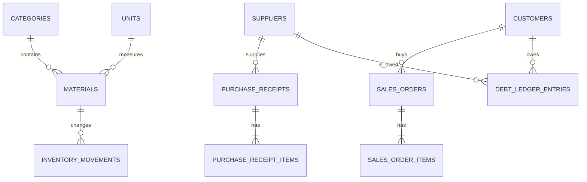

# DATABASE.md

## 1. Mục đích

Tài liệu này mô tả thiết kế cơ sở dữ liệu cho hệ thống quản lý kho vật liệu xây dựng. Đây là nguồn tham chiếu khi AI hoặc lập trình viên tạo schema, migration, entity/model, service và API.

Mục tiêu:

- Đảm bảo đúng tồn kho, doanh thu và công nợ.
- Truy vết được mọi nghiệp vụ.
- Không sửa trực tiếp dữ liệu kho/tài chính đã xác nhận.
- Hỗ trợ nhiều lần thanh toán cho một chứng từ.
- Đủ đơn giản cho MVP và có đường mở rộng rõ ràng.

Nếu tài liệu này mâu thuẫn với `BUSINESS_RULES.md`, ưu tiên `BUSINESS_RULES.md` và cập nhật lại tài liệu này.

---

## 2. Công nghệ và quy ước

### 2.1. Database

- Khuyến nghị PostgreSQL 16+.
- Mọi thay đổi schema phải qua migration.
- Thời điểm lưu bằng UTC; backend chuyển múi giờ khi hiển thị.
- Production phải bật backup tự động và kiểm tra restore định kỳ.

### 2.2. Kiểu dữ liệu chuẩn

| Dữ liệu | Kiểu đề xuất | Ghi chú |
|---|---|---|
| Khóa chính | `UUID` | Sinh tại backend hoặc database |
| Số lượng | `NUMERIC(18,3)` | Hỗ trợ kg, tấn, m³ và số lẻ |
| Tiền VND | `BIGINT` | Lưu số nguyên, không dùng float |
| Tỷ lệ | `NUMERIC(7,4)` | Thuế suất hoặc phần trăm |
| Ngày nghiệp vụ | `DATE` | Ngày nhập, bán, kiểm kho |
| Thời điểm | `TIMESTAMPTZ` | Lưu UTC |
| Metadata/audit | `JSONB` | Không thay thế cột nghiệp vụ |

Quy ước:

- Tên bảng/cột dùng `snake_case`; bảng dùng danh từ số nhiều.
- Khóa chính là `id`; khóa ngoại là `<entity>_id`.
- Bảng chính có `created_at`, `updated_at`.
- Danh mục đã được tham chiếu không hard delete; dùng `is_active = false`.
- Chứng từ nghiệp vụ không hard delete.
- Mọi phép tính tiền phải được tính lại ở backend.

---

## 3. Enum

```text
UserRole =
  ADMIN | WAREHOUSE_STAFF | SALES

DocumentStatus =
  DRAFT | CONFIRMED | CANCELLED

PaymentStatus =
  UNPAID | PARTIALLY_PAID | PAID | OVERPAID

PaymentMethod =
  CASH | BANK_TRANSFER | OTHER

InventoryMovementType =
  PURCHASE_IN |
  SALE_OUT |
  SALE_RETURN_IN |
  PURCHASE_RETURN_OUT |
  ADJUSTMENT_IN |
  ADJUSTMENT_OUT |
  REVERSAL_IN |
  REVERSAL_OUT

DebtDirection =
  RECEIVABLE | PAYABLE

DebtEntryType =
  CHARGE | PAYMENT | RETURN | REVERSAL | ADJUSTMENT
```

Quy ước chứng từ:

- `DRAFT`: được chỉnh sửa, chưa ảnh hưởng tồn kho/công nợ.
- `CONFIRMED`: đã ghi nhận; không sửa nội dung trực tiếp.
- `CANCELLED`: đã hủy; ảnh hưởng cũ phải được đảo bằng giao dịch đối ứng.

---

## 4. Quan hệ tổng quát



---

## 5. Người dùng và danh mục

### 5.1. `users`

| Cột | Kiểu | Ràng buộc/Ghi chú |
|---|---|---|
| `id` | UUID | PK |
| `full_name` | VARCHAR(150) | NOT NULL |
| `email` | VARCHAR(255) | NOT NULL, UNIQUE, lowercase |
| `password_hash` | VARCHAR(255) | NOT NULL |
| `role` | UserRole | NOT NULL |
| `is_active` | BOOLEAN | NOT NULL, default true |
| `last_login_at` | TIMESTAMPTZ | NULL |
| `created_at` | TIMESTAMPTZ | NOT NULL |
| `updated_at` | TIMESTAMPTZ | NOT NULL |

Không xóa tài khoản đã phát sinh nghiệp vụ; chỉ vô hiệu hóa.

### 5.2. `categories`

| Cột | Kiểu | Ràng buộc/Ghi chú |
|---|---|---|
| `id` | UUID | PK |
| `code` | VARCHAR(50) | NOT NULL, UNIQUE |
| `name` | VARCHAR(150) | NOT NULL |
| `description` | TEXT | NULL |
| `is_active` | BOOLEAN | NOT NULL, default true |
| `created_at` | TIMESTAMPTZ | NOT NULL |
| `updated_at` | TIMESTAMPTZ | NOT NULL |

### 5.3. `units`

| Cột | Kiểu | Ràng buộc/Ghi chú |
|---|---|---|
| `id` | UUID | PK |
| `code` | VARCHAR(30) | NOT NULL, UNIQUE |
| `name` | VARCHAR(100) | NOT NULL |
| `precision` | SMALLINT | NOT NULL, default 0, CHECK 0..3 |
| `is_active` | BOOLEAN | NOT NULL, default true |
| `created_at` | TIMESTAMPTZ | NOT NULL |
| `updated_at` | TIMESTAMPTZ | NOT NULL |

MVP: một vật liệu chỉ có một đơn vị tính, không quy đổi đơn vị.

### 5.4. `materials`

| Cột | Kiểu | Ràng buộc/Ghi chú |
|---|---|---|
| `id` | UUID | PK |
| `sku` | VARCHAR(80) | NOT NULL, UNIQUE |
| `name` | VARCHAR(200) | NOT NULL |
| `category_id` | UUID | NOT NULL, FK categories |
| `unit_id` | UUID | NOT NULL, FK units |
| `description` | TEXT | NULL |
| `default_purchase_price` | BIGINT | NOT NULL, default 0, CHECK >= 0 |
| `default_sale_price` | BIGINT | NOT NULL, default 0, CHECK >= 0 |
| `minimum_stock` | NUMERIC(18,3) | NOT NULL, default 0, CHECK >= 0 |
| `current_stock` | NUMERIC(18,3) | NOT NULL, default 0, CHECK >= 0 |
| `is_active` | BOOLEAN | NOT NULL, default true |
| `created_at` | TIMESTAMPTZ | NOT NULL |
| `updated_at` | TIMESTAMPTZ | NOT NULL |

`current_stock` là số tổng hợp để đọc nhanh. Nguồn lịch sử chính thức là `inventory_movements`. Không cung cấp API sửa trực tiếp cột này.

### 5.5. `customers`

| Cột | Kiểu | Ràng buộc/Ghi chú |
|---|---|---|
| `id` | UUID | PK |
| `code` | VARCHAR(50) | NOT NULL, UNIQUE |
| `name` | VARCHAR(200) | NOT NULL |
| `phone` | VARCHAR(30) | NULL |
| `email` | VARCHAR(255) | NULL |
| `address` | TEXT | NULL |
| `tax_code` | VARCHAR(50) | NULL |
| `note` | TEXT | NULL |
| `is_active` | BOOLEAN | NOT NULL, default true |
| `created_at` | TIMESTAMPTZ | NOT NULL |
| `updated_at` | TIMESTAMPTZ | NOT NULL |

Tạo bản ghi hệ thống `WALK_IN_CUSTOMER` cho khách mua lẻ; không được xóa/vô hiệu hóa.

### 5.6. `suppliers`

| Cột | Kiểu | Ràng buộc/Ghi chú |
|---|---|---|
| `id` | UUID | PK |
| `code` | VARCHAR(50) | NOT NULL, UNIQUE |
| `name` | VARCHAR(200) | NOT NULL |
| `contact_name` | VARCHAR(150) | NULL |
| `phone` | VARCHAR(30) | NULL |
| `email` | VARCHAR(255) | NULL |
| `address` | TEXT | NULL |
| `tax_code` | VARCHAR(50) | NULL |
| `note` | TEXT | NULL |
| `is_active` | BOOLEAN | NOT NULL, default true |
| `created_at` | TIMESTAMPTZ | NOT NULL |
| `updated_at` | TIMESTAMPTZ | NOT NULL |

Nợ đầu kỳ không lưu như một số dư có thể sửa trực tiếp. Khi nhập dữ liệu đầu kỳ phải tạo dòng `ADJUSTMENT` trong sổ công nợ.

---

## 6. Nhập hàng

### 6.1. `purchase_receipts`

| Cột | Kiểu | Ràng buộc/Ghi chú |
|---|---|---|
| `id` | UUID | PK |
| `code` | VARCHAR(50) | NOT NULL, UNIQUE, sinh tại server |
| `supplier_id` | UUID | NOT NULL, FK suppliers |
| `receipt_date` | DATE | NOT NULL |
| `status` | DocumentStatus | NOT NULL, default DRAFT |
| `subtotal` | BIGINT | NOT NULL, CHECK >= 0 |
| `discount_amount` | BIGINT | NOT NULL, default 0, CHECK >= 0 |
| `shipping_fee` | BIGINT | NOT NULL, default 0, CHECK >= 0 |
| `tax_amount` | BIGINT | NOT NULL, default 0, CHECK >= 0 |
| `total_amount` | BIGINT | NOT NULL, CHECK >= 0 |
| `paid_amount` | BIGINT | NOT NULL, default 0, CHECK >= 0 |
| `debt_amount` | BIGINT | NOT NULL, default 0, CHECK >= 0 |
| `payment_status` | PaymentStatus | NOT NULL, default UNPAID |
| `supplier_invoice_number` | VARCHAR(100) | NULL |
| `note` | TEXT | NULL |
| `created_by` | UUID | NOT NULL, FK users |
| `confirmed_by`, `cancelled_by` | UUID | NULL, FK users |
| `confirmed_at`, `cancelled_at` | TIMESTAMPTZ | NULL |
| `cancellation_reason` | TEXT | NULL |
| `created_at`, `updated_at` | TIMESTAMPTZ | NOT NULL |

```text
total_amount = subtotal - discount_amount + shipping_fee + tax_amount
paid_amount  = tổng payment hợp lệ
debt_amount  = total_amount - giá trị trả hàng - paid_amount
```

### 6.2. `purchase_receipt_items`

| Cột | Kiểu | Ràng buộc/Ghi chú |
|---|---|---|
| `id` | UUID | PK |
| `purchase_receipt_id` | UUID | NOT NULL, FK purchase_receipts |
| `material_id` | UUID | NOT NULL, FK materials |
| `material_sku_snapshot` | VARCHAR(80) | NOT NULL |
| `material_name_snapshot` | VARCHAR(200) | NOT NULL |
| `unit_name_snapshot` | VARCHAR(100) | NOT NULL |
| `quantity` | NUMERIC(18,3) | NOT NULL, CHECK > 0 |
| `unit_price` | BIGINT | NOT NULL, CHECK >= 0 |
| `discount_amount` | BIGINT | NOT NULL, default 0, CHECK >= 0 |
| `line_total` | BIGINT | NOT NULL, CHECK >= 0 |
| `created_at`, `updated_at` | TIMESTAMPTZ | NOT NULL |

MVP dùng `UNIQUE(purchase_receipt_id, material_id)`. Nếu cần cùng vật liệu nhưng nhiều lô/giá, bỏ unique này và bổ sung quản lý lô.

---

## 7. Bán hàng

### 7.1. `sales_orders`

Đơn bán kiêm phiếu xuất trong MVP.

| Cột | Kiểu | Ràng buộc/Ghi chú |
|---|---|---|
| `id` | UUID | PK |
| `code` | VARCHAR(50) | NOT NULL, UNIQUE, sinh tại server |
| `customer_id` | UUID | NOT NULL, FK customers |
| `sale_date` | DATE | NOT NULL |
| `status` | DocumentStatus | NOT NULL, default DRAFT |
| `subtotal` | BIGINT | NOT NULL, CHECK >= 0 |
| `discount_amount` | BIGINT | NOT NULL, default 0, CHECK >= 0 |
| `shipping_fee` | BIGINT | NOT NULL, default 0, CHECK >= 0 |
| `tax_amount` | BIGINT | NOT NULL, default 0, CHECK >= 0 |
| `total_amount` | BIGINT | NOT NULL, CHECK >= 0 |
| `paid_amount` | BIGINT | NOT NULL, default 0, CHECK >= 0 |
| `debt_amount` | BIGINT | NOT NULL, default 0, CHECK >= 0 |
| `payment_status` | PaymentStatus | NOT NULL, default UNPAID |
| `delivery_address` | TEXT | NULL |
| `note` | TEXT | NULL |
| `created_by` | UUID | NOT NULL, FK users |
| `confirmed_by`, `cancelled_by` | UUID | NULL, FK users |
| `confirmed_at`, `cancelled_at` | TIMESTAMPTZ | NULL |
| `cancellation_reason` | TEXT | NULL |
| `created_at`, `updated_at` | TIMESTAMPTZ | NOT NULL |

### 7.2. `sales_order_items`

| Cột | Kiểu | Ràng buộc/Ghi chú |
|---|---|---|
| `id` | UUID | PK |
| `sales_order_id` | UUID | NOT NULL, FK sales_orders |
| `material_id` | UUID | NOT NULL, FK materials |
| `material_sku_snapshot` | VARCHAR(80) | NOT NULL |
| `material_name_snapshot` | VARCHAR(200) | NOT NULL |
| `unit_name_snapshot` | VARCHAR(100) | NOT NULL |
| `quantity` | NUMERIC(18,3) | NOT NULL, CHECK > 0 |
| `unit_price` | BIGINT | NOT NULL, CHECK >= 0 |
| `discount_amount` | BIGINT | NOT NULL, default 0, CHECK >= 0 |
| `line_total` | BIGINT | NOT NULL, CHECK >= 0 |
| `created_at`, `updated_at` | TIMESTAMPTZ | NOT NULL |

MVP dùng `UNIQUE(sales_order_id, material_id)`. Các snapshot giữ lịch sử không đổi khi danh mục được sửa.

---

## 8. Thanh toán và công nợ

### 8.1. `customer_payments`

Một đơn bán có thể được thanh toán nhiều lần.

| Cột | Kiểu | Ràng buộc/Ghi chú |
|---|---|---|
| `id` | UUID | PK |
| `code` | VARCHAR(50) | NOT NULL, UNIQUE |
| `customer_id` | UUID | NOT NULL, FK customers |
| `sales_order_id` | UUID | NOT NULL trong MVP, FK sales_orders |
| `payment_date` | DATE | NOT NULL |
| `amount` | BIGINT | NOT NULL, CHECK > 0 |
| `method` | PaymentMethod | NOT NULL |
| `reference_number` | VARCHAR(150) | NULL |
| `note` | TEXT | NULL |
| `reversal_of_id` | UUID | NULL, self FK |
| `reversal_reason` | TEXT | NULL |
| `created_by` | UUID | NOT NULL, FK users |
| `created_at` | TIMESTAMPTZ | NOT NULL |

Không update/delete phiếu thu đã ghi nhận. Khi sai, tạo một phiếu đảo liên kết bằng `reversal_of_id`.

### 8.2. `supplier_payments`

| Cột | Kiểu | Ràng buộc/Ghi chú |
|---|---|---|
| `id` | UUID | PK |
| `code` | VARCHAR(50) | NOT NULL, UNIQUE |
| `supplier_id` | UUID | NOT NULL, FK suppliers |
| `purchase_receipt_id` | UUID | NOT NULL trong MVP, FK purchase_receipts |
| `payment_date` | DATE | NOT NULL |
| `amount` | BIGINT | NOT NULL, CHECK > 0 |
| `method` | PaymentMethod | NOT NULL |
| `reference_number` | VARCHAR(150) | NULL |
| `note` | TEXT | NULL |
| `reversal_of_id` | UUID | NULL, self FK |
| `reversal_reason` | TEXT | NULL |
| `created_by` | UUID | NOT NULL, FK users |
| `created_at` | TIMESTAMPTZ | NOT NULL |

### 8.3. `debt_ledger_entries`

Nguồn lịch sử công nợ chính thức.

| Cột | Kiểu | Ràng buộc/Ghi chú |
|---|---|---|
| `id` | UUID | PK |
| `direction` | DebtDirection | NOT NULL |
| `customer_id` | UUID | NULL, FK customers |
| `supplier_id` | UUID | NULL, FK suppliers |
| `entry_type` | DebtEntryType | NOT NULL |
| `entry_date` | DATE | NOT NULL |
| `amount_delta` | BIGINT | NOT NULL, khác 0; tăng nợ dương, giảm nợ âm |
| `source_type` | VARCHAR(50) | NOT NULL |
| `source_id` | UUID | NOT NULL |
| `description` | TEXT | NULL |
| `created_by` | UUID | NOT NULL, FK users |
| `reversal_of_id` | UUID | NULL, self FK |
| `created_at` | TIMESTAMPTZ | NOT NULL |

Ràng buộc:

```text
direction = RECEIVABLE => customer_id NOT NULL, supplier_id NULL
direction = PAYABLE    => supplier_id NOT NULL, customer_id NULL
UNIQUE(source_type, source_id, entry_type)
```

Cách tính:

```text
customer_debt = sale charges - sale returns - receipts +/- adjustments
supplier_debt = purchase charges - purchase returns - payments +/- adjustments
```

Không lưu `current_debt` có thể chỉnh trực tiếp trên khách hàng/nhà cung cấp.

---

## 9. Lịch sử tồn kho

### 9.1. `inventory_movements`

Mỗi dòng là một lần tăng/giảm tồn. Đây là nguồn lịch sử tồn kho chính thức.

| Cột | Kiểu | Ràng buộc/Ghi chú |
|---|---|---|
| `id` | UUID | PK |
| `material_id` | UUID | NOT NULL, FK materials |
| `movement_type` | InventoryMovementType | NOT NULL |
| `movement_date` | DATE | NOT NULL |
| `quantity_delta` | NUMERIC(18,3) | NOT NULL, khác 0; nhập dương, xuất âm |
| `unit_cost` | BIGINT | NULL, CHECK >= 0 |
| `source_type` | VARCHAR(50) | NOT NULL |
| `source_id` | UUID | NOT NULL |
| `source_item_id` | UUID | NOT NULL |
| `reversal_of_id` | UUID | NULL, self FK |
| `note` | TEXT | NULL |
| `created_by` | UUID | NOT NULL, FK users |
| `created_at` | TIMESTAMPTZ | NOT NULL |

Ràng buộc idempotency đề xuất:

```text
UNIQUE(source_type, source_item_id, movement_type)
```

Không update/delete movement. Hủy chứng từ phải tạo movement đảo.

Đối soát:

```text
materials.current_stock = SUM(inventory_movements.quantity_delta)
```

---

## 10. Trả hàng

### 10.1. `sales_returns`

| Cột | Kiểu | Ràng buộc/Ghi chú |
|---|---|---|
| `id` | UUID | PK |
| `code` | VARCHAR(50) | NOT NULL, UNIQUE |
| `sales_order_id` | UUID | NOT NULL, FK sales_orders |
| `customer_id` | UUID | NOT NULL, FK customers |
| `return_date` | DATE | NOT NULL |
| `status` | DocumentStatus | NOT NULL, default DRAFT |
| `total_amount` | BIGINT | NOT NULL, CHECK >= 0 |
| `refund_amount` | BIGINT | NOT NULL, default 0, CHECK >= 0 |
| `reason` | TEXT | NOT NULL |
| `created_by`, `confirmed_by`, `cancelled_by` | UUID | FK users |
| `confirmed_at`, `cancelled_at` | TIMESTAMPTZ | NULL |
| `created_at`, `updated_at` | TIMESTAMPTZ | NOT NULL |

### 10.2. `sales_return_items`

| Cột | Kiểu | Ràng buộc/Ghi chú |
|---|---|---|
| `id` | UUID | PK |
| `sales_return_id` | UUID | NOT NULL, FK sales_returns |
| `sales_order_item_id` | UUID | NOT NULL, FK sales_order_items |
| `material_id` | UUID | NOT NULL, FK materials |
| `quantity` | NUMERIC(18,3) | NOT NULL, CHECK > 0 |
| `unit_price` | BIGINT | NOT NULL, CHECK >= 0 |
| `line_total` | BIGINT | NOT NULL, CHECK >= 0 |
| `created_at` | TIMESTAMPTZ | NOT NULL |

Tổng đã trả không vượt số lượng đã bán. Xác nhận tạo `SALE_RETURN_IN` và giảm công nợ; nếu hoàn tiền thật phải có phiếu chi/ledger riêng.

### 10.3. `purchase_returns`

Cột tương tự `sales_returns`, thay bằng:

- `purchase_receipt_id` FK `purchase_receipts`.
- `supplier_id` FK `suppliers`.

### 10.4. `purchase_return_items`

Cột tương tự `sales_return_items`, thay bằng:

- `purchase_return_id` FK `purchase_returns`.
- `purchase_receipt_item_id` FK `purchase_receipt_items`.

Tổng đã trả không vượt số lượng đã nhập và không được làm tồn âm. Xác nhận tạo `PURCHASE_RETURN_OUT` và giảm công nợ nhà cung cấp.

---

## 11. Kiểm kho và điều chỉnh

### 11.1. `stocktakes`

| Cột | Kiểu | Ràng buộc/Ghi chú |
|---|---|---|
| `id` | UUID | PK |
| `code` | VARCHAR(50) | NOT NULL, UNIQUE |
| `stocktake_date` | DATE | NOT NULL |
| `status` | DocumentStatus | NOT NULL, default DRAFT |
| `note` | TEXT | NULL |
| `created_by`, `confirmed_by`, `cancelled_by` | UUID | FK users |
| `confirmed_at`, `cancelled_at` | TIMESTAMPTZ | NULL |
| `cancellation_reason` | TEXT | NULL |
| `created_at`, `updated_at` | TIMESTAMPTZ | NOT NULL |

### 11.2. `stocktake_items`

| Cột | Kiểu | Ràng buộc/Ghi chú |
|---|---|---|
| `id` | UUID | PK |
| `stocktake_id` | UUID | NOT NULL, FK stocktakes |
| `material_id` | UUID | NOT NULL, FK materials |
| `system_quantity` | NUMERIC(18,3) | NOT NULL, CHECK >= 0 |
| `actual_quantity` | NUMERIC(18,3) | NOT NULL, CHECK >= 0 |
| `difference_quantity` | NUMERIC(18,3) | NOT NULL |
| `reason` | TEXT | Bắt buộc nếu chênh lệch khác 0 |
| `created_at`, `updated_at` | TIMESTAMPTZ | NOT NULL |

Ràng buộc:

```text
UNIQUE(stocktake_id, material_id)
difference_quantity = actual_quantity - system_quantity
```

Xác nhận tạo `ADJUSTMENT_IN` hoặc `ADJUSTMENT_OUT`; không sửa tồn trực tiếp.

---

## 12. Audit, sequence và idempotency

### 12.1. `audit_logs`

| Cột | Kiểu | Ràng buộc/Ghi chú |
|---|---|---|
| `id` | UUID | PK |
| `user_id` | UUID | NULL, FK users; NULL cho system |
| `action` | VARCHAR(100) | NOT NULL |
| `entity_type` | VARCHAR(100) | NOT NULL |
| `entity_id` | UUID | NULL |
| `old_data` | JSONB | NULL, loại bỏ dữ liệu nhạy cảm |
| `new_data` | JSONB | NULL, loại bỏ dữ liệu nhạy cảm |
| `ip_address` | INET | NULL |
| `user_agent` | TEXT | NULL |
| `request_id` | VARCHAR(100) | NULL |
| `created_at` | TIMESTAMPTZ | NOT NULL |

Audit chỉ append, không update/delete qua API.

### 12.2. `document_sequences`

| Cột | Kiểu | Ràng buộc/Ghi chú |
|---|---|---|
| `document_type` | VARCHAR(50) | Composite PK |
| `sequence_date` | DATE | Composite PK |
| `current_value` | BIGINT | NOT NULL, CHECK >= 0 |
| `updated_at` | TIMESTAMPTZ | NOT NULL |

Ví dụ: `PN-20260914-0001`, `BH-20260914-0001`, `PT-20260914-0001`. Tăng sequence phải atomic.

### 12.3. `idempotency_keys`

| Cột | Kiểu | Ràng buộc/Ghi chú |
|---|---|---|
| `id` | UUID | PK |
| `key` | VARCHAR(150) | NOT NULL, UNIQUE |
| `operation` | VARCHAR(100) | NOT NULL |
| `request_hash` | VARCHAR(128) | NOT NULL |
| `resource_type` | VARCHAR(100) | NULL |
| `resource_id` | UUID | NULL |
| `response_status` | INTEGER | NULL |
| `response_body` | JSONB | NULL |
| `expires_at` | TIMESTAMPTZ | NOT NULL |
| `created_at` | TIMESTAMPTZ | NOT NULL |

Cùng key nhưng khác `request_hash` phải bị từ chối.

---

## 13. Transaction bắt buộc

### 13.1. Xác nhận phiếu nhập

Trong một database transaction:

1. Khóa phiếu và kiểm tra còn `DRAFT`.
2. Validate nhà cung cấp, vật liệu và item.
3. Tính lại toàn bộ tiền ở backend.
4. Chuyển sang `CONFIRMED`.
5. Tạo `PURCHASE_IN` cho từng item.
6. Tăng `materials.current_stock` bằng update atomic.
7. Tạo `CHARGE` công nợ nhà cung cấp.
8. Nếu trả ngay, tạo payment và `PAYMENT` ledger.
9. Cập nhật `paid_amount`, `debt_amount`, `payment_status`.
10. Ghi audit.

Một bước lỗi phải rollback toàn bộ.

### 13.2. Xác nhận đơn bán

Trong một database transaction:

1. Khóa đơn và kiểm tra còn `DRAFT`.
2. Khóa các material theo thứ tự ID cố định để hạn chế deadlock.
3. Kiểm tra đủ tồn.
4. Tính lại tiền.
5. Chuyển sang `CONFIRMED`.
6. Tạo `SALE_OUT`.
7. Trừ tồn bằng update có điều kiện `current_stock >= quantity`.
8. Tạo `CHARGE` công nợ khách.
9. Nếu thu ngay, tạo payment và `PAYMENT` ledger.
10. Cập nhật trạng thái thanh toán và audit.

Không tách kiểm tra tồn và trừ tồn thành hai transaction.

### 13.3. Ghi nhận thanh toán

1. Khóa chứng từ gốc.
2. Chứng từ phải `CONFIRMED`.
3. Amount > 0 và không vượt số nợ còn lại trong MVP.
4. Tạo payment.
5. Tạo ledger `PAYMENT`.
6. Tính lại các số tổng hợp/trạng thái.
7. Ghi audit.

### 13.4. Hủy chứng từ

- Không xóa movement/payment/ledger cũ.
- Tạo movement và ledger đảo, liên kết bằng `reversal_of_id`.
- Đảo phiếu nhập không được làm tồn âm.
- Nếu có thanh toán hoặc trả hàng, xử lý chứng từ phụ theo đúng thứ tự.
- Bắt buộc lưu người hủy, thời điểm và lý do.

---

## 14. Ràng buộc toàn vẹn

Backend và database cùng bảo vệ:

1. Không tồn kho âm.
2. Quantity > 0; tiền không âm; payment > 0.
3. Chứng từ có ít nhất một item trước khi xác nhận.
4. Không xác nhận một chứng từ hai lần.
5. Chỉ `DRAFT` được sửa nội dung.
6. Không thay item của chứng từ đã xác nhận.
7. Không xóa danh mục đã được tham chiếu.
8. Customer của payment phải trùng customer của đơn.
9. Supplier của payment phải trùng supplier của phiếu nhập.
10. Tổng lượng trả không vượt lượng gốc.
11. Mỗi movement/ledger chỉ sinh một lần cho cùng nguồn.
12. `CONFIRMED` bắt buộc có `confirmed_at`, `confirmed_by`.
13. `CANCELLED` bắt buộc có người, thời điểm và lý do hủy.

Kiểm tra liên bảng phải đặt trong service transaction và có integration test; CHECK constraint đơn thuần không đủ.

---

## 15. Index đề xuất

```text
materials(category_id, is_active)
materials(name)
customers(phone)
customers(name)
suppliers(phone)
suppliers(name)

purchase_receipts(supplier_id, receipt_date DESC)
purchase_receipts(status, receipt_date DESC)
purchase_receipts(payment_status, receipt_date DESC)
purchase_receipt_items(material_id)

sales_orders(customer_id, sale_date DESC)
sales_orders(status, sale_date DESC)
sales_orders(payment_status, sale_date DESC)
sales_order_items(material_id)

inventory_movements(material_id, movement_date, created_at)
inventory_movements(source_type, source_id)

debt_ledger_entries(customer_id, entry_date, created_at)
debt_ledger_entries(supplier_id, entry_date, created_at)
debt_ledger_entries(source_type, source_id)

customer_payments(customer_id, payment_date DESC)
customer_payments(sales_order_id)
supplier_payments(supplier_id, payment_date DESC)
supplier_payments(purchase_receipt_id)

audit_logs(entity_type, entity_id, created_at DESC)
audit_logs(user_id, created_at DESC)
```

Chỉ thêm full-text/`pg_trgm` khi dữ liệu và query thực tế cần.

---

## 16. Nguồn dữ liệu báo cáo

| Báo cáo | Nguồn chính |
|---|---|
| Tồn hiện tại | `materials.current_stock`, đối soát movements |
| Thẻ kho | `inventory_movements` |
| Nhập hàng | Phiếu nhập/items `CONFIRMED` |
| Bán hàng/doanh thu | Đơn bán/items trừ trả hàng |
| Công nợ khách | Ledger `RECEIVABLE` |
| Công nợ nhà cung cấp | Ledger `PAYABLE` |
| Lịch sử thu/chi | Customer/supplier payments và bút toán đảo |
| Hàng sắp hết | `current_stock <= minimum_stock` |
| Chênh lệch kiểm kho | Stocktakes/items |

Doanh thu không đồng nghĩa tiền đã thu:

- Doanh thu dựa trên hàng bán hợp lệ sau giảm giá và trả hàng.
- Dòng tiền dựa trên payment.
- Công nợ là phần chưa thanh toán sau các điều chỉnh hợp lệ.

---

## 17. Đối soát định kỳ

Job kiểm tra phải phát hiện:

1. `current_stock` khác tổng movement.
2. `paid_amount` khác tổng payment hợp lệ.
3. `debt_amount` khác ledger.
4. Chứng từ confirmed thiếu movement/ledger.
5. Movement hoặc ledger trùng nguồn.
6. Phiếu trả vượt chứng từ gốc.
7. Chứng từ cancelled thiếu bút toán đảo.

Không tự sửa âm thầm. Sai lệch phải được cảnh báo và sửa bằng nghiệp vụ điều chỉnh có lý do/audit.

---

## 18. Seed data

Môi trường mới nên có:

- Một ADMIN ban đầu, cấu hình qua biến môi trường.
- Đơn vị: viên, bao, cây, kg, tấn, m, m², m³.
- Nhóm vật liệu mẫu chỉ cho development.
- Khách lẻ `WALK_IN_CUSTOMER`.
- Sequence cho từng loại chứng từ.

Không commit mật khẩu, token hoặc dữ liệu khách hàng thật.

---

## 19. Bảo mật và vận hành

- Dùng TLS và tài khoản database riêng cho ứng dụng.
- Tài khoản ứng dụng không có quyền drop database/schema.
- Không trả `password_hash` qua API.
- Loại bỏ password, token, cookie khỏi log/audit.
- Dùng connection pool và timeout cho query/transaction.
- Backup trước migration production.
- Thử migration trên staging và có kế hoạch rollback.
- Backup chỉ được xem là an toàn khi đã thử restore thành công.

---

## 20. Ngoài phạm vi MVP

Chưa thiết kế chi tiết:

- Nhiều kho và chuyển kho.
- Quy đổi nhiều đơn vị.
- Lô, vị trí kệ, serial, hạn sử dụng.
- Đơn đặt mua tách phiếu nhập.
- Báo giá, giao nhiều đợt, hóa đơn điện tử.
- Một payment phân bổ nhiều chứng từ.
- Tiền trả trước và hạn mức tín dụng.
- Đa tiền tệ.
- FIFO/bình quân tức thời nâng cao.
- Kế toán kép và báo cáo tài chính đầy đủ.

Khi mở rộng phải cập nhật `BUSINESS_RULES.md`, tài liệu này và migration trước khi code.

---

## 21. Checklist trước khi sinh code

- [ ] Xác nhận ORM/framework trong `PROJECT.md`.
- [ ] Map enum thống nhất giữa database, backend và frontend.
- [ ] Tạo FK, UNIQUE và CHECK constraint.
- [ ] Có transaction cho confirm/cancel/payment/return/stocktake.
- [ ] Không có API sửa trực tiếp stock/paid/debt tổng hợp.
- [ ] Có idempotency cho xác nhận và thanh toán.
- [ ] Test concurrent sale không làm âm kho.
- [ ] Test rollback khi confirm thất bại.
- [ ] Test hủy và bút toán đảo.
- [ ] Test trả hàng không vượt số lượng gốc.
- [ ] Test đối soát tồn kho và công nợ.
- [ ] Seed không chứa secret.
- [ ] Backup và restore đã được kiểm tra.

